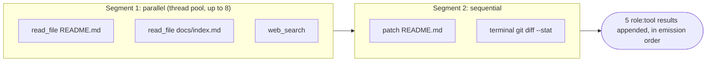
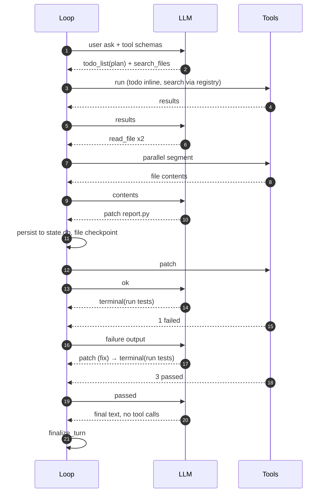
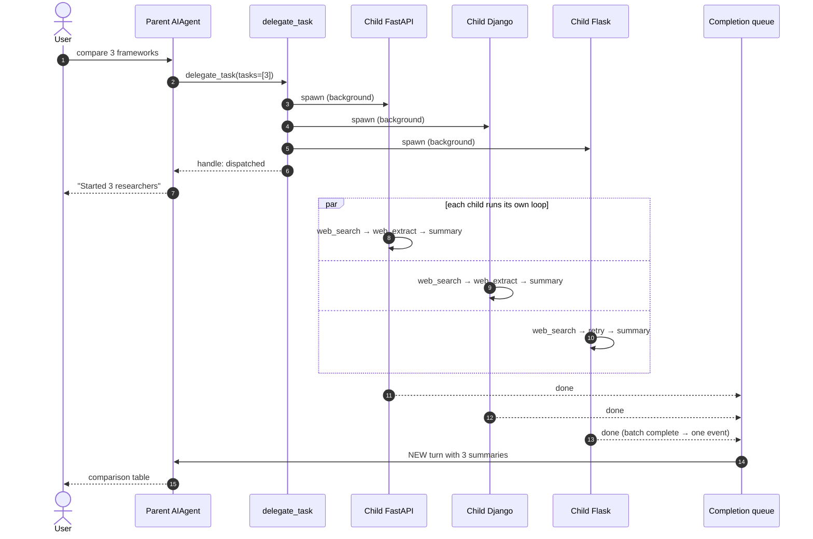

# Agent Loop by Example

Worked traces of the Hermes turn loop: one tool call, many tool calls in one reply, a
plan → validate → execute coding task, several sub-agents at once, and error recovery.
The architecture behind these traces is in [ONBOARDING.md §4A](ONBOARDING.md#4a-deep-dive-the-agent-loop-and-tool-calls).

Names you will see:

| Term | Meaning | Where |
|---|---|---|
| **turn** | One `run_conversation()` call: user message in, final answer out | `agent/turn_facade.py` |
| **iteration** | One trip round the loop = **one LLM API call** | `agent/conversation_loop.py::_run_conversation_turn` |
| **tool round** | Running every tool call from one LLM reply | `agent/turn_tool_round.py::run_tool_round` |
| `messages` | The growing transcript sent on every call | `_LoopState.messages` |
| budget | `max_iterations` + `iteration_budget` (shared with sub-agents; a child defaults to 250) | `run_agent.py`, `tools/delegate_tool.py` |

> **Plan → validate → execute is not a hard-coded mode.** The loop is generic: *call the LLM → run
> its tool calls → repeat*. The plan / validate / execute shape comes from the model using
> tools in that order: `todo_list` to plan, read tools to check, write tools to act, `terminal`
> to verify. The loop *does* validate every tool call itself before running it (step 1 of every
> tool round). `/plan` is a separate slash command that only writes a plan file to `.hermes/plans/`
> and executes nothing.

---

## Example 1 — One tool call (the minimum)

User: *"What's my Python version?"*

```
iter 1  LLM → tool_calls=[terminal("python --version")]
        loop: validate ✓ → append assistant msg → persist to state.db → run → append tool result
iter 2  LLM → "You're on Python 3.14.0."   (no tool_calls)
        loop: finish_text_response → finalize_turn → return
```
**2 API calls, 1 tool run.** `messages` grew by 3 rows: assistant (with the tool call), tool result, and the final assistant answer.

What `messages` looks like going into iter 2:
```json
[
 {"role":"system","content":"<cached system prompt>"},
 {"role":"user","content":"What's my Python version?"},
 {"role":"assistant","content":"","tool_calls":[{"id":"call_1","function":{"name":"terminal","arguments":"{\"command\":\"python --version\"}"}}]},
 {"role":"tool","tool_call_id":"call_1","name":"terminal","content":"{\"output\":\"Python 3.14.0\",\"exit_code\":0}"}
]
```

---

## Example 2 — Many tool calls in ONE reply (parallel + sequential)

User: *"Compare the README with the docs index, check what's new upstream, add a 'What's new' line to the README, and show me the diff."*

The LLM returns **5 tool calls in a single reply**:
```
tool_calls = [ read_file("README.md"),
               read_file("website/docs/index.md"),
               web_search("hermes agent release notes"),
               patch("README.md", ...),
               terminal("git diff --stat") ]
```
`run_agent.py::_execute_tool_calls` sees more than one call, so it asks
`agent/tool_dispatch_helpers.py::_plan_tool_batch_segments` to split them:



Why it splits this way:
- `read_file` ×2 and `web_search` are parallel-safe and don't conflict, so they run **at the same time**.
- `patch README.md` writes a path that an earlier call in this run reads. A writer that overlaps any reserved path closes the
  parallel run, so the read always sees the file **before** the patch.
- `terminal` is not parallel-safe, so it is a barrier. The leftover run of one call (`patch`) is demoted to sequential and
  merged with `terminal`.
- Order is never changed: a later call never jumps ahead of an earlier barrier, and the results come back in emission order.

This is still **one iteration**: 1 API call made, 5 tools run. The next iteration sends all 5 results back to the LLM.

The rules (`_batch_admission`, `_plan_tool_batch_segments`):
- **Parallel-safe:** `read_file`, `search_files`, `web_search`, `web_extract`, `vision_analyze`, `skill_view`,
  `skills_list`, `session_search`, `image_generate`, and MCP tools that opted in.
- **Path-scoped:** `read_file` / `search_files` (readers) and `write_file` / `patch` (writers). Readers may overlap
  each other. A writer conflicts with *any* overlapping path, so two writes to different files *can* run in parallel.
- **Always a barrier:** `terminal` and every other tool not listed above, `_NEVER_PARALLEL_TOOLS` (`clarify`, …),
  and calls whose arguments can't be parsed.
- A parallel run needs at least 2 calls. Approval prompts from parallel calls queue through one
  `_ConcurrentToolAuthorizationGate`, so they never overlap on screen.

---

## Example 3 — Plan → validate → execute (a coding task)

User: *"Add a `--json` flag to `scripts/report.py` and make sure the tests pass."*

| iter | LLM reply (tool calls) | What the loop does | Phase |
|---|---|---|---|
| 1 | `todo_list([{1 read code},{2 add flag},{3 run tests}])` + `search_files("argparse", "scripts/")` | `todo_list` runs **inline** (agent state); search runs via `handle_function_call` | **PLAN** |
| 2 | `read_file scripts/report.py` + `read_file tests/test_report.py` | both read-only, so a **parallel** segment | **VALIDATE** (understand before touching) |
| 3 | `patch scripts/report.py` + `todo_list(1 ✓, 2 in_progress)` | **saved before execute**; a file checkpoint is taken before the first write (`_ensure_file_checkpoint`) so `/rollback` can undo it | **EXECUTE** |
| 4 | `terminal("scripts/run_tests.sh tests/test_report.py")` | output: `1 failed: KeyError 'rows'` → returned to the model as a tool result | **VALIDATE** |
| 5 | `patch scripts/report.py` (fix) | sequential write | **EXECUTE** |
| 6 | `terminal(run_tests…)` + `todo_list(all ✓)` | `3 passed` | **VALIDATE** |
| 7 | text: *"Added `--json`; tests pass. Changed: …"* | no tool calls → stop gates → `finalize_turn` | done |

**7 API calls, 9 tool runs, 1 turn.** Points to notice:
- The **loop never decides "plan" or "test"**. It only runs whatever the model asks for and feeds back results. A test failure isn't an error to the loop. It is just tool output, and the model reacts to it on the next iteration.
- If the user types `/steer use click instead`, the note is attached to the current tool batch's results (`_apply_pending_steer_to_tool_results`), so the model reads it on the next iteration. A stop request (`_interrupt_requested`) gives the remaining queued tools "cancelled" results.
- If the transcript gets too long mid-task, `run_preflight_gate` compresses it before the next API call (it prunes old tool outputs first, then has an auxiliary model summarize) and the loop carries on.
- The `todo_list` survives compression: active items are re-injected, so the plan isn't lost.



---

## Example 4 — Several sub-agents at once

User (in Telegram): *"Research the 3 most popular Python web frameworks and give me a comparison."*

### 4a. The parent fans out
The parent LLM returns **one** `delegate_task` call with a batch:
```json
{"name":"delegate_task","arguments":{
  "context":"User wants a comparison: performance, ecosystem, learning curve.",
  "tasks":[
    {"goal":"Research FastAPI: performance, ecosystem, learning curve. Cite sources."},
    {"goal":"Research Django: performance, ecosystem, learning curve. Cite sources."},
    {"goal":"Research Flask: performance, ecosystem, learning curve. Cite sources."}
  ]}}
```
In the tool round, `delegate_task` is routed to `AIAgent._dispatch_delegate_task` (`run_agent.py`), **not**
`handle_function_call`. Then:

1. `tools/delegate_tool.py::delegate_task` checks the spawn pause switch, the depth limit
   (`depth < max_spawn_depth`, default 1) and the spawn budget, and normalizes the 3 tasks.
2. `_build_children` builds **3 child `AIAgent`s**. Each one gets:
   - a fresh conversation (it sees only its own goal + `context`, never the parent's chat)
   - the parent's tools **minus** `delegate_task`, `clarify`, `memory`, `send_message` and `cronjob_manage`
   - its own session row in `state.db`, a live transcript log, and a compression cap
3. **Top-level delegations always run in the background.** `delegate_task` returns a handle
   straight away (status `dispatched`, with a `delegation_id`). It falls back to running synchronously, with a
   note, when the session can't receive detached results or the async pool is full (default 3 delegation calls
   in flight).
4. The parent loop continues: the LLM sees "dispatched" and replies *"I've started 3 researchers,
   I'll report back."* **The parent's turn ends, and the user can keep chatting.**

### 4b. Children run their own loops, concurrently
Each child runs **exactly the same `run_conversation` loop**, in parallel threads
(`tools/delegate_tool_dispatch.py::_run_children_parallel`), all on the background pool in
`tools/async_delegation.py`. One call can have up to 10 children (`delegation.max_concurrent_children`).

```
child FastAPI : iter1 web_search ×3 (parallel) → iter2 web_extract ×2 → iter3 text summary  ✓
child Django  : iter1 web_search ×2           → iter2 web_extract     → iter3 text summary  ✓
child Flask   : iter1 web_search              → iter2 rate-limit → retry → iter3 summary    ✓
```

### 4c. Results come back as a NEW turn
- By default the batch is **one async unit** (setting `delegation.independent_completions` splits it by task `group`). When every child has finished, a single consolidated `async_delegation`
  event is pushed onto the shared completion queue, and recorded in the `async_delegations` table so it survives a crash.
- The CLI or gateway drains that queue **while idle** and starts a new parent turn. Results are never injected mid-turn, because that would break the prompt cache.
- In that new turn, the parent LLM gets the 3 summaries and writes the comparison table for the user.



**What the parent sees:** only the 3 final summaries. It never sees the children's searches or reasoning.
**Budget:** each child's API calls count against the shared iteration budget.
**Control while running:** `delegate_task(action="list" | "steer" | "stop", subagent_id=…)`, or the TUI `/agents` panel.

### 4d. Nested sub-agents (orchestrators)
- By default a child **cannot** delegate (depth limit 1, and `delegate_task` is blocked).
- If you raise `delegation.max_spawn_depth` in `config.yaml`, a child at depth > 0 can become an orchestrator. Its delegations then run **synchronously**: it waits for its own children's results inside its turn, because it needs them before it can answer.
- Every extra level multiplies API cost.

---

## Example 5 — When things go wrong (recovery loops)

| Situation | Where it's caught | What happens | Counts as an iteration? |
|---|---|---|---|
| Model calls a tool that doesn't exist | `validate_tool_calls` | error result `"unknown tool X, valid: …"`, and the model retries next iteration | yes (the next call) |
| Tool arguments are invalid JSON | `validate_tool_calls` / `_parse_tool_arguments` | error result for that call only; other calls in the batch still run | yes |
| 429 rate limit / 5xx | `_run_api_retry_loop` → `handle_api_error` | back off and retry the **same** request | no (retries stay inside one iteration) |
| Provider down / model unavailable | `turn_recovery*.py` | switch to `fallback_model` and rebuild the request | no |
| 413 / context overflow | `turn_overflow.py` | compress, then retry | no |
| Reply cut off (`finish_reason=length`) | `turn_truncation.py` | ask the model to continue, then join the parts | yes |
| Empty reply / thinking only | `turn_empty_response.py` | nudge and retry | yes |
| Tool hangs | `tool_executor.py` timeouts + heartbeat | timeout result is returned to the model | — |
| User presses stop | `begin_iteration`, the stream, and before each sequential tool | queued tools get "cancelled" results and the turn ends with partial text | — |
| Saving to `state.db` fails before tools run | `run_tool_round` | **no tool runs**; the turn ends | — |
| Budget used up | loop `while` condition | one grace call to write a final answer, then `finalize_turn` | the grace call |

---

## Cheat sheet: counting

```
1 turn       = 1 run_conversation()                     (one user message)
1 iteration  = 1 LLM API call (+ its retries)           (api_call_count += 1)
1 tool round = all tool_calls from one LLM reply        (split into parallel / sequential segments)
1 sub-agent  = 1 child AIAgent running its own full loop (top-level: background; result = a new parent turn)
```
