# Hermes Agent: Onboarding Guide for New Engineers

> Diagrams are Mermaid; GitHub renders them inline.

A from-zero walkthrough of this repo: the stack, the architecture at 16,000 ft, 10 ft and 1 ft, the folder structure, and the features. For the rules you must follow when you change code, see the root `AGENTS.md` and each area's `AGENTS.md`.

## 1. What Hermes is, in one paragraph
Hermes (by Nous Research, MIT license) is a **personal AI agent**. It is an LLM that can run tools: shell, files, browser, web search, code execution, sub-agents, cron jobs. You can talk to it from many front-ends: a terminal REPL, a rich TUI, an Electron desktop app, a web dashboard, and about 20 chat platforms (Telegram, Discord, Slack, WhatsApp, Matrix, Teams…). It also **learns across sessions**: it keeps memory files (`MEMORY.md`, `USER.md`) and **skills** (`SKILL.md` instruction packs), and it can create or improve skills itself. One agent core serves every front-end.

Two design rules explain most of the code:
1. **Prompt caching is sacred.** The system prompt stays byte-identical for a whole conversation. Changing it mid-conversation breaks the cached prefix and multiplies cost. Context compression is the only allowed exception.
2. **The core is a "narrow waist".** Every tool schema is sent on every API call, so new core tools are rare. New features arrive as plugins, skills, CLI commands or service-gated tools.

---

## 2. The stack

| Layer | Technology |
|---|---|
| Main language | **Python 3.14** (`.python-version`; pyproject allows `>=3.11,<3.15`) |
| Packaging / envs | `pyproject.toml`, **uv** lockfile (`uv.lock`), its own env manager `pm/`, Nix flake (`flake.nix`, `nix/`) |
| LLM SDKs | `openai` (core; also used for OpenRouter and any OpenAI-compatible API), `anthropic`, `mistralai`, `boto3` (Bedrock), Vertex, Azure (optional extras) |
| Web / API | FastAPI + uvicorn, httpx, websockets, pydantic v2 |
| CLI / terminal | `prompt_toolkit` (REPL), `rich` (rendering), `fire` |
| Storage | **SQLite** (WAL mode, FTS5 full-text search, with a custom CJK tokenizer in `native/fts5_cjk`), plus YAML/JSON/Markdown files |
| Scheduling | `croniter` |
| Protocols | **MCP** (`mcp`), **ACP** (Agent Client Protocol, for editors), JSON-RPC (TUI) |
| Messaging SDKs | python-telegram-bot, discord.py, slack-bolt, and others (optional extras) |
| Sandboxes | Docker, SSH, Modal, Daytona, Singularity, Vercel (terminal backends) |
| TUI | **React + Ink** (forked as `@hermes/ink`), nanostores, esbuild, vitest (`ui-tui/`) |
| Desktop | **Electron** + React + Vite + Tailwind + assistant-ui + TanStack Query (`apps/desktop/`) |
| Web dashboard | React + Vite + react-router + Tailwind + xterm.js (`web/`) |
| Installer | Tauri (`apps/bootstrap-installer/`) |
| Docs site | Docusaurus (`website/`) |
| JS monorepo | npm workspaces (root `package.json`), TypeScript, ESLint, Prettier, lefthook |

Entry points (`[project.scripts]`): `hermes` → `hermes_cli.main:main`, `hermes-agent` → `agent.legacy_cli:main`, `hermes-acp` → `acp_adapter.entry:main`.

---

**Stack layers at a glance:**

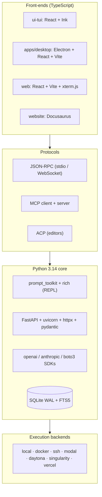

## 3. Architecture at 16,000 ft (the big picture)

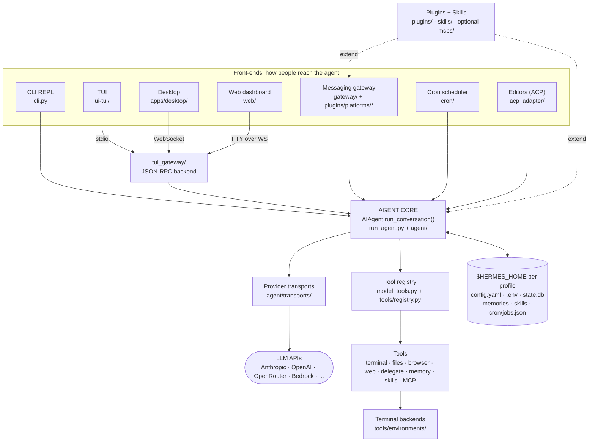

How to read it: **many front-ends, one brain, one state folder per profile.** A *profile* is a separate `HERMES_HOME` (`~/.hermes/profiles/<name>`), chosen with `-p`. One process can serve several profiles, so code that runs outside a turn must bind the right profile explicitly.

---

## 4. Architecture at 10 ft (subsystems and how they connect)

### 4.1 Agent core: `run_agent.py` + `agent/`
- `AIAgent` (`run_agent.py`) is a **facade** built from about 14 mixins. Its constructor passes about 60 kwargs (model, provider, `api_mode`, toolsets, session ids, callbacks…) to `agent/agent_init.py::init_agent`.
- Public entry points are in `agent/turn_facade.py`: `run_conversation(user_message, ...)` returns a dict with `final_response` and `messages`; `chat(msg)` returns a string.
- The loop driver is `agent/conversation_loop.py::_run_conversation_turn`. It runs a chain of **phase files** `agent/turn_*.py`. Each phase returns a verdict: continue, break or return.
- **Providers / transports** (`agent/transports/`): one transport per `api_mode`:
  - `chat_completions`: OpenAI, OpenRouter and other compatible APIs
  - `anthropic_messages`: Anthropic
  - `codex_responses`: OpenAI Responses API
  - `bedrock_converse`: AWS Bedrock
  - `codex_app_server`: hands the turn to a codex subprocess

  Each transport converts messages and tools to the vendor format and normalizes the response back. Vendor profiles live in `plugins/model-providers/<vendor>/` and `providers/`.
- **Prompt** is built in `agent/system_prompt.py`, in three tiers: stable (identity/SOUL.md), context (AGENTS.md/CLAUDE.md/.cursorrules files), and volatile (skills index, memory snapshot, time, environment). It is built once and cached.
- **Compression** (`agent/context_compressor.py`): first prunes old tool results without an LLM call, then has an auxiliary model summarize the middle while keeping the head and tail. It triggers at about 50% of the context window, or manually with `/compress`.
- **Caching** (`agent/prompt_caching.py`): places Anthropic-style cache markers on each request.

**Turn loop (one call to `run_conversation`):**

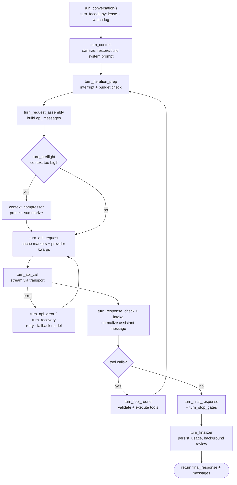

For the full walkthrough of the loop and tool calls, see [§4A](#4a-deep-dive-the-agent-loop-and-tool-calls).

### 4.2 Tools: `tools/`, `model_tools.py`, `toolsets.py`
- Each tool module calls `registry.register(...)` at import time (`tools/registry.py`). `discover_builtin_tools()` finds these modules by scanning their syntax trees.
- `toolsets.py` defines `TOOLSETS`, named groups like `web`, `terminal`, `file`, `browser`, `coding`, `hermes-telegram`. Groups can include other groups. `_HERMES_CORE_TOOLS` is the default core list.
- `model_tools.handle_function_call` is the dispatch pipeline: argument coercion → middleware → approval and pre-tool hooks → `registry.dispatch` → post-tool hooks. It returns a JSON string.
- The terminal tool runs commands through a pluggable backend in `tools/environments/` (local, docker, ssh, modal, daytona, singularity, vercel_sandbox). The backend is picked with `TERMINAL_ENV`.

**Tool dispatch pipeline:**

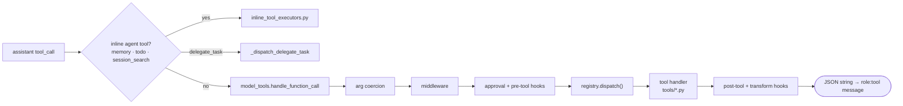

### 4.3 Messaging gateway: `gateway/`
- `gateway/run.py::GatewayRunner` is a facade over phase files (`run_startup`, `run_adapters`, `run_inbound*`, `run_turn*`, `run_busy`, `run_shutdown`).
- Platform adapters subclass `gateway/platforms/base.py::BasePlatformAdapter`. Most of them (Telegram, Discord, Slack…) live in `plugins/platforms/<name>/adapter.py` and register through `gateway/platform_registry.py`.
- Sessions: `gateway/session.py::build_session_key` produces keys like `<ns>:<platform>:<chat_type>:<chat_id>:<thread>:<user>`. `SessionStore` maps each key to a conversation.
- Streaming: `gateway/stream_consumer.py` receives token deltas from the agent and edits or sends chat messages live.

**Gateway inbound path:**

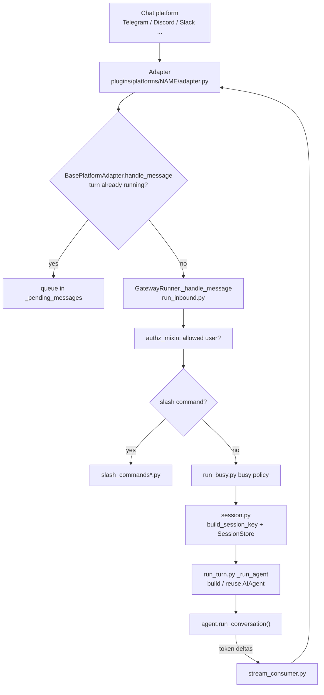

### 4.4 TUI, Desktop and Web
- `ui-tui/` (Node/Ink) draws the screen. `tui_gateway/` (Python) owns the agent. They talk **newline-delimited JSON-RPC over stdio**. The wire contracts are Pydantic models in `tui_gateway/contracts/`, generated into TypeScript.
- The Desktop app launches `hermes serve` and talks to the same `tui_gateway` over **WebSocket** (`tui_gateway/ws.py`, client in `apps/shared`).
- The Web dashboard backend is `hermes_cli/web_server*.py` plus `hermes_cli/web_routers/`. Its chat page embeds the real TUI in xterm.js through a PTY WebSocket (`hermes_cli/pty_bridge.py`).

### 4.5 CLI: `cli.py` + `hermes_cli/`
- `hermes_cli/main.py::main` resolves `-p profile` into `HERMES_HOME` before other imports. It then builds an argparse tree (`hermes_cli/subcommands/*`) and dispatches.
- Main subcommands: chat, setup, model, gateway, cron, skills, plugins, profile, sessions, memory, tools, mcp, doctor, update, dashboard/serve, desktop, logs, pm…
- `cli.py::HermesCLI` is the prompt_toolkit REPL, made of mixins in `hermes_cli/cli_*_mixin.py`.
- Slash commands are defined once in `hermes_cli/commands.py::COMMAND_REGISTRY` (about 100 `CommandDef`s). The CLI, the gateway, Telegram menus and autocomplete all read that one list.

### 4.6 Cron: `cron/`
- Jobs are stored in `$HERMES_HOME/cron/jobs.json` (`cron/jobs.py`).
- `cron/scheduler_tick.py::tick` runs under a file lock and advances `next_run_at`.
- `cron/scheduler.py::run_job` builds an `AIAgent`, runs it under a watchdog, and delivers the output back to a chat platform.
- The ticker thread runs inside the gateway.

### 4.7 State: `hermes_state.py` + `hermes_state_*.py`
- `SessionDB` is backed by SQLite at `$HERMES_HOME/state.db`.
- Main tables: `sessions`, `messages`, `system_prompts`, `session_model_usage`, `async_delegations`, `gateway_routing`, … plus FTS5 tables for searching message history.
- Compression creates a *child* session linked by `parent_session_id`.

### 4.8 Plugins: `plugins/`, `hermes_cli/plugins*.py`
- `PluginManager` discovers plugins in this order: bundled `plugins/` → `$HERMES_HOME/plugins` → project `.hermes/plugins` (opt-in) → pip entry points (`hermes_agent.plugins`).
- `PluginContext.register_*` lets a plugin add tools, CLI commands, slash commands, platforms, memory providers, context engines, hooks and middleware.
- Plugin kinds: model-provider, platform, backend, standalone. Also bundled: memory (byterover, retaindb), image_gen, video_gen, browser, kanban, dashboard_auth.

**Plugin discovery and registration:**

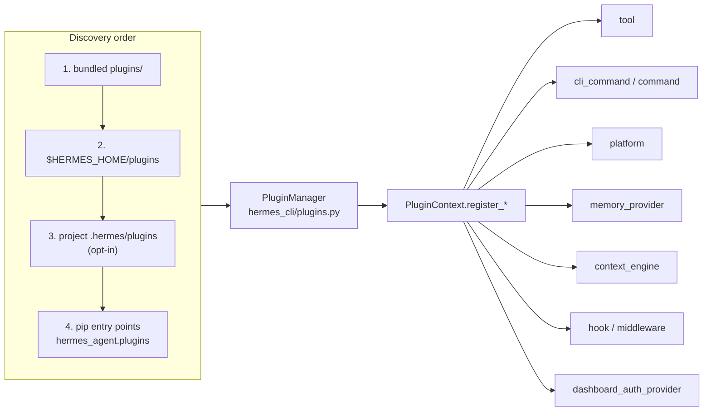

### 4.9 Memory and skills
- **Memory:** `tools/memory_tool*.py` maintains `MEMORY.md` (about 2.2k chars of agent notes) and `USER.md` (about 1.4k chars of user profile). A frozen snapshot goes into the prompt at session start. Writes reach disk immediately but only show up in the *next* session (cache safety). External memory providers plug in through `agent/memory_provider.py` and `agent/memory_manager.py`.
- **Skills:** a skill is a folder with `SKILL.md` (YAML frontmatter + instructions) and optional `references/`, `scripts/` and `templates/` folders. Only a name and description index sits in the prompt. The model calls `skill_view` to load the full content when it needs it. `skill_manage` lets the agent write its own skills, and `agent/curator.py` curates them.

**Memory and skills lifecycle (cache-safe):**

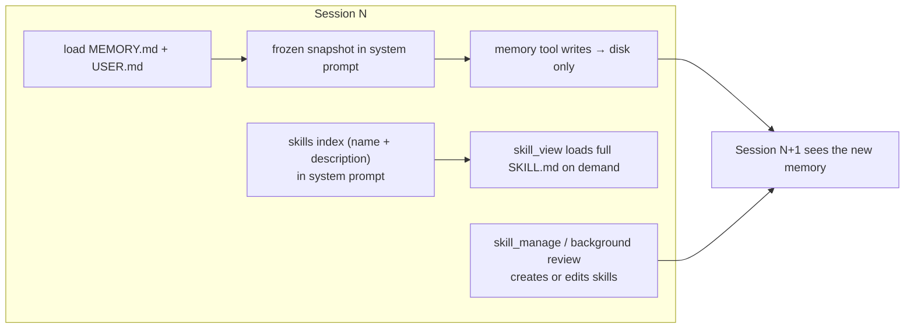

### 4.10 Delegation: `tools/delegate_tool*.py`
- `delegate_task` spawns a child `AIAgent` with:
  - a fresh conversation
  - a focused prompt
  - the parent's tools minus `delegate_task`, `clarify`, `memory`, `send_message` and `cronjob_manage`
  - a shared iteration budget
  - an optional isolated git worktree
- Depth defaults to 1 level of nesting. Tasks can run in parallel or in the background (`tools/async_delegation.py`).
- The parent sees only the child's summary.

**Delegation:**

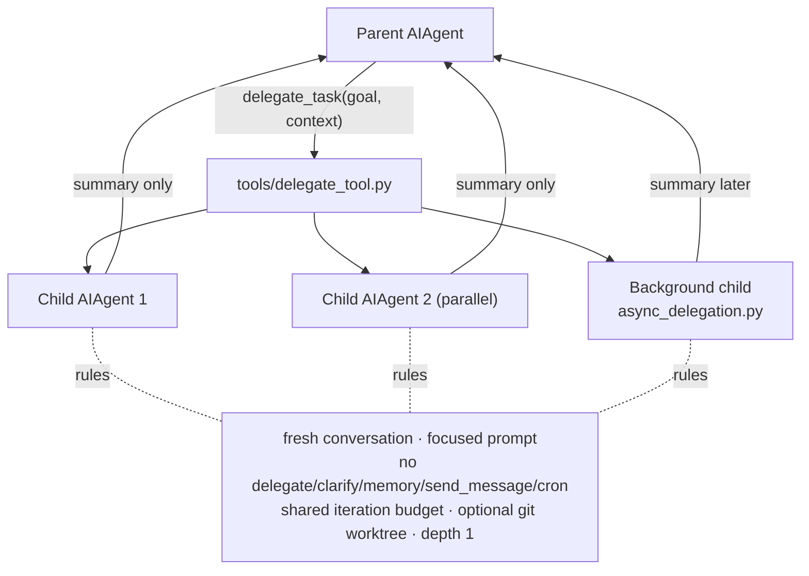

---

## 4A. Deep dive: the agent loop and tool calls

Worked traces with many tool calls, plan → validate → execute, several sub-agents and error recovery: [AGENT_LOOP_EXAMPLES.md](AGENT_LOOP_EXAMPLES.md).

Traced from `agent/conversation_loop.py`, `agent/turn_tool_round.py`, `agent/tool_executor.py`, `run_agent.py`, `model_tools.py`, `tools/registry.py` and `agent/transports/base.py`.

### 4A.1 The core idea in 4 lines
```
messages = [system, ...history, user]
loop:
    reply = LLM(messages, tools)              # one "API call"
    if reply has tool_calls: run them, append results, loop again
    else: reply text is the final answer → stop
```
Everything else in the code is safety around this loop: budgets, retries, compression, caching, approvals, persistence and interrupts.

---

### 4A.2 Who calls the loop
Every front-end ends up making the same call:
```python
result = agent.run_conversation(user_message, conversation_history=history)
# → {"final_response": "...", "messages": [...full updated transcript...]}
```
- **CLI** `cli.py` · **gateway** `gateway/run_turn_runner.py` · **TUI** `tui_gateway/methods_*.py` · **cron** `cron/scheduler.py::run_job` · **sub-agents** `tools/delegate_tool.py`
- `AIAgent.run_conversation` (`agent/turn_facade.py`) first takes a **session turn lease**, so no two processes run the same session at once, and starts a **liveness watchdog**. Then it calls `agent/conversation_loop.py::run_conversation` → `_run_conversation_turn`.

---

### 4A.3 The real loop (`agent/conversation_loop.py:_run_conversation_turn`, ~line 1547)

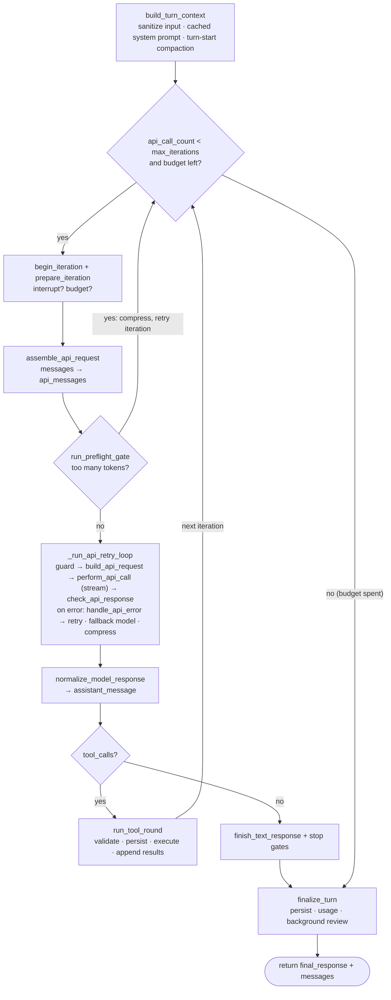

How the phases are wired:
- Each box is a **phase function** in its own `agent/turn_*.py` file.
- The loop runs every phase through `_run_phase(fn, agent, state)`. `_run_phase` reads the phase's parameter names, passes in the matching fields of `_LoopState` (`messages`, `api_call_count`, `assistant_message` …), and copies the returned **verdict** fields back into the state.
- Each verdict carries an `action`: `"continue"` (go to the next iteration), `"break"` (leave the loop and finalize) or `"return"` (end the turn now with `.result`).
- This is why the loop body is short: it only routes on `.action`.

Two counters stop runaway loops:
- `agent.max_iterations`: how many API calls this agent may make.
- `agent.iteration_budget`: a budget **shared with sub-agents**.

When the budget runs out, the agent gets one "grace" call (`_budget_grace_call`) to write a final answer.

---

### 4A.4 One API call, in detail

#### 4a. Building the request (`turn_request_assembly.py`, `turn_api_request.py`)
1. `assemble_api_request` copies `messages` into `api_messages`. It adds the **cached system prompt**, which was built once by `agent/system_prompt.py` and never changes mid-session.
2. `build_api_request` does three things:
   - picks `tools_for_api`, the JSON schemas from `model_tools.get_tool_definitions(enabled_toolsets)`
   - re-applies **prompt-cache markers** for the current provider (`_redecorate_prompt_cache_for_provider`, which uses `agent/prompt_caching.py`)
   - lets the transport build provider kwargs

#### 4b. Transports: how one loop talks to many vendors (`agent/transports/`)
Every provider adapter implements `ProviderTransport` (`agent/transports/base.py`):
```python
class ProviderTransport(ABC):
    def convert_messages(self, messages, **kw)   # OpenAI-style → vendor format
    def convert_tools(self, tools)               # tool schemas → vendor format
    def build_kwargs(...)                        # model, max_tokens, reasoning, cache...
    def normalize_response(self, response, **kw) -> NormalizedResponse  # vendor → common shape
    def map_finish_reason(self, raw)             # "end_turn"/"tool_use" → "stop"/"tool_calls"
```
- Inside the loop, every message uses **one common shape** (OpenAI chat style: `role`, `content`, `tool_calls`, `tool_call_id`). Conversion happens only at the edge.
- `api_mode` picks the transport: `chat_completions` (OpenAI, OpenRouter, local servers), `anthropic_messages`, `codex_responses`, `bedrock_converse`. With `codex_app_server` the whole turn is handed to a subprocess and this loop is skipped.

#### 4c. Sending (`turn_api_call.py::perform_api_call`)
- **Streaming is preferred.** `_interruptible_streaming_api_call` sends each text delta to `agent.stream_delta_callback`. That callback drives the CLI display, the TUI, or the gateway's `stream_consumer.py`, which edits the chat message live.
- Calls are **interruptible**. If the user hits stop or sends `/steer`, `InterruptedError` is raised and `handle_api_interrupt` keeps the partial text.
- On an exception, `handle_api_error` (+ `turn_recovery*.py`, `turn_overflow.py`) classifies it:
  - rate limit → back off and retry
  - auth or billing → stop with guidance
  - context too large (413/overflow) → compress, then retry
  - provider down → switch to `fallback_model`

  All of this stays inside `_run_api_retry_loop`.

#### 4d. Reading the reply (`turn_response_check.py`, `turn_response_intake.py`)
- `check_api_response` validates the shape.
- `normalize_model_response` produces `s.assistant_message` with `.content`, `.tool_calls` and reasoning. Special cases:
  - `finish_reason == "length"` → `turn_truncation.py` asks the model to continue and joins the parts
  - empty or thinking-only reply → `turn_empty_response.py` nudges a retry

---

### 4A.5 Tool calls, in detail

#### 5a. What a tool call looks like
The model returns:
```json
{"role":"assistant","content":"Let me check.",
 "tool_calls":[{"id":"call_1","type":"function",
   "function":{"name":"terminal","arguments":"{\"command\":\"ls ~/Downloads\"}"}}]}
```
After the tool runs, the loop appends exactly one result per call:
```json
{"role":"tool","tool_call_id":"call_1","name":"terminal","content":"{\"output\":\"a.pdf\\nb.zip\",\"exit_code\":0}"}
```
On the next iteration the model sees that result and decides what to do next.

#### 5b. `run_tool_round` (`agent/turn_tool_round.py:49`): the order matters
1. **Validate** (`validate_tool_calls`): unknown tool names and bad JSON get an error result, so the model can correct itself.
2. **Guardrails:**
   - `expand_local_tool_batches`
   - `_cap_delegate_task_calls` (limits sub-agent spawns)
   - `_deduplicate_tool_calls` (drops identical repeats)
3. **Stage + append** the assistant message to `messages`. Every emitted call keeps a matching result, and invalid ones get error results.
4. **Persist before execute:** `_flush_messages_to_session_db` writes to `state.db` *before* any tool runs. If a destructive tool crashes or restarts Hermes, a resume can see what was being executed. If the save fails, the turn stops and **no tools run**.
5. `agent._execute_tool_calls(...)` runs the calls (5c).
6. If the context is getting large, compress after the tools. Then return `continue`, so the loop makes the next API call.

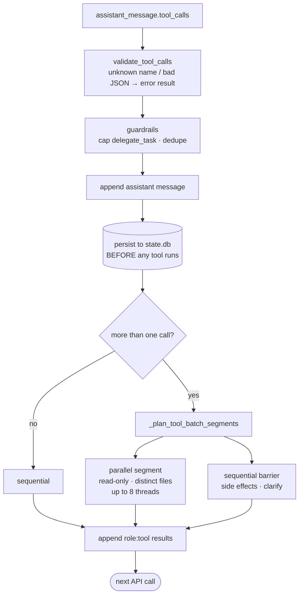

#### 5c. Sequential vs parallel (`run_agent.py:1299` → `agent/tool_executor.py`)
```python
if len(tool_calls) <= 1:
    sequential
else:
    segments = _plan_tool_batch_segments(tool_calls, execution_cwd)
    # e.g. [("parallel",[read_file a, read_file b, web_search]), ("sequential",[terminal]), ...]
```
- **Parallel-safe** calls are read-only, touch different files, or are MCP tools that opted in. They run in a thread pool of up to **8 workers** (`_MAX_TOOL_WORKERS`); image generation has its own lower cap.
- Calls with side effects run as **sequential barriers**, in the order the model emitted them.
- `clarify` and a few other interactive tools are `_NEVER_PARALLEL_TOOLS` (`agent/tool_dispatch_helpers.py:30`).
- Approval prompts in parallel batches go through one `_ConcurrentToolAuthorizationGate`, so prompts never overlap on screen.
- Before each sequential call the executor checks `_interrupt_requested`. If the user stopped the turn, the remaining calls get "cancelled" results.
- Every tool has a timeout and an activity heartbeat. Large results are spilled to disk, and only a preview stays in context.

#### 5d. Dispatching one call: three routes
| Tool | Route |
|---|---|
| `memory`, `todo_list`, `session_search`, … (need agent state) | `agent/inline_tool_executors.py` (handled in-agent) |
| `delegate_task` | `AIAgent._dispatch_delegate_task` → `tools/delegate_tool.py` (child AIAgent) |
| everything else | `model_tools.handle_function_call(name, args, task_id, ...)` (`model_tools.py:873`) |

The `handle_function_call` pipeline:
```
coerce args to schema types
 → tool-search bridge (unwrap deferred tools)
 → request middleware (plugins)
 → _pre_dispatch_guards: approval for dangerous commands + pre_tool_call hooks (can block)
 → registry.dispatch(name, args)  → handler in tools/<x>.py  (async handlers run via _run_async)
 → post_tool_call hook + transform_tool_result hook
 → always returns a JSON STRING (exceptions become {"error": "..."})
```

#### 5e. How tools get into the registry (`tools/registry.py`)
```python
# tools/web_tools.py — runs at import time
registry.register(
    name="web_search", toolset="web", schema=WEB_SEARCH_SCHEMA,
    handler=lambda args, **kw: web_search_tool(args.get("query",""), limit=args.get("limit",5)),
    check_fn=check_web_api_key,      # tool is hidden if this returns False (no API key)
    requires_env=_web_requires_env(), emoji="🔍", max_result_size_chars=100_000,
)
```
- `discover_builtin_tools()` scans `tools/*.py` for `registry.register(` calls in the syntax tree (cached on disk) and imports those modules.
- Plugins add tools with `PluginContext.register_tool`, and MCP servers add theirs through `tools/mcp_tool*.py`.
- `toolsets.py` decides which registered tools this agent may use. For example, `hermes-telegram` is a bundle of `web`, `terminal`, `file`, …

---

### 4A.6 Worked example: two iterations

User: *"What's in my Downloads and how big is it?"*

| # | Model sends back | Loop does |
|---|---|---|
| iter 1 | `tool_calls=[terminal("ls ~/Downloads"), terminal("du -sh ~/Downloads")]` | validate → append assistant msg → **persist** → plan segments. Both are side-effecting terminal calls, so they run sequentially → append 2 `role:tool` results → `continue` |
| iter 2 | `content="You have 12 files (2.3 GB): ..."`, no tool calls | `finish_text_response` → stop gates pass → `break` |
| end | — | `finalize_turn` saves to `state.db`, records token usage, may start a background memory/skill review. Returns `{"final_response": "You have 12 files…", "messages": [...]}` |

That is **2 API calls** and **2 tool executions**: `api_call_count` = 2, and the shared iteration budget went down by 2.

---

### 4A.7 Cross-cutting rules the loop protects
- **Prompt cache:** the system prompt is built once (`_cached_system_prompt`) and reused byte-for-byte every iteration. Memory written mid-turn shows up only in the *next* session. Only compression may rebuild it.
- **Compression** (`agent/context_compressor.py`) runs at three points: turn start (`turn_context_compaction.py`), before each call (`run_preflight_gate`), and after tool results. It first prunes old tool outputs without an LLM call, then has an auxiliary model summarize the middle while keeping the head and tail. It creates a child session linked by `parent_session_id`.
- **Durability:** the assistant/tool-call rows are saved to the DB before tools run, and results are saved as they complete. If a save fails, the turn ends instead of continuing from in-memory state.
- **Interrupts / steer:** checked at each iteration start, during the API stream, and before each sequential tool.
- **Sub-agents:** `delegate_task` builds a child `AIAgent` and runs this same loop with fewer tools and the shared budget. The parent gets only the summary.

---

## 5. Architecture at 1 ft (one message, line by line)

Example: a user sends "what's in my Downloads folder?" on Telegram.

1. `plugins/platforms/telegram/adapter.py` receives the update and builds a `MessageEvent`. `handle_message()` passes it to `BasePlatformAdapter.handle_message` (`gateway/platforms/base.py`). If this chat already has a turn running, the message is queued in `_pending_messages`.
2. Otherwise the message handler installed in `gateway/run_adapters.py` calls `GatewayRunner._handle_message` (`gateway/run_inbound.py`). That step handles:
   - **authorization** (`authz_mixin.py`)
   - **slash commands** (`slash_commands*.py`)
   - the **busy policy** (`run_busy.py`)
3. `gateway/session.py::build_session_key` + `SessionStore.get_or_create_session` find the conversation. Its history is loaded from `state.db`.
4. `gateway/run_turn.py::_run_agent` builds an `AIAgent` (or reuses one from `run_agent_cache.py`) with `platform="telegram"` and the toolset `hermes-telegram`. It sets `agent.stream_delta_callback = GatewayStreamConsumer.on_delta`.
5. `gateway/run_turn_runner.py` calls `agent.run_conversation(user_message, conversation_history=…)`.
6. `turn_facade.run_conversation` takes a **session turn lease** (so no two processes run the same session) and starts a liveness watchdog.
7. `turn_context.build_turn_context` sanitizes the input and restores the cached system prompt, or builds it with `system_prompt.build_system_prompt`. If the context is too large, compaction runs here.
8. Loop iteration (`conversation_loop`):
   1. `turn_iteration_prep`: check interrupts and the budget.
   2. `turn_request_assembly.assemble_api_request`: build `api_messages`.
   3. `turn_preflight*`: compress if needed.
   4. `turn_api_request.build_api_request`: apply cache markers and provider kwargs.
   5. `turn_api_call.perform_api_call`: send a streaming request through the transport (for example `transports/anthropic.py`). Tokens flow to the Telegram stream consumer.
   6. `turn_response_check` + `turn_response_intake.normalize_model_response` → assistant message with `tool_calls=[terminal(command="ls ~/Downloads")]`.
9. `turn_tool_round.run_tool_round` validates the calls (`turn_tool_validation.py`) and runs them with `agent/tool_executor.py` → `model_tools.handle_function_call("terminal", …)`, which goes through approval and hooks to `registry.dispatch`. `tools/terminal_tool.py` runs `ls` in the configured backend (`tools/environments/local.py`). The JSON result is appended as a `{"role":"tool"}` message.
10. The loop runs again. The model now answers in text with no tool calls, so `turn_final_response.finish_text_response` runs, then `turn_stop_gates`.
11. `turn_finalizer.finalize_turn` saves messages to `state.db`, records usage (`turn_usage.py`), and may start a background memory or skill review (`agent/background_review.py`). It returns `{"final_response": …, "messages": …}`.
12. The gateway sends or finalizes the Telegram message through the stream consumer and the adapter.

**The same trace as a sequence diagram:**

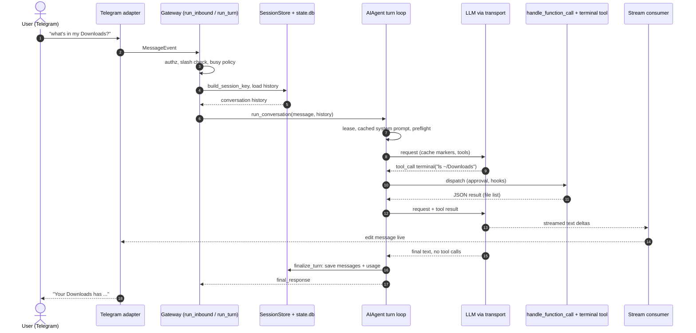

The same path from the CLI starts at `cli.py::HermesCLI.run` (prompt_toolkit input). From the TUI it starts at a `tui_gateway` JSON-RPC method. From cron it starts at `cron/scheduler.py::run_job`. Steps 6–11 are identical in every case.

How a tool is registered (`tools/web_tools.py`):
```python
registry.register(
    name="web_search", toolset="web", schema=WEB_SEARCH_SCHEMA,
    handler=lambda args, **kw: web_search_tool(args.get("query", ""), limit=args.get("limit", 5)),
    check_fn=check_web_api_key, requires_env=_web_requires_env(), emoji="🔍",
    max_result_size_chars=100_000,
)
```
`check_fn` decides whether the tool is offered at all, for example only when an API key is present.

---

## 6. Folder structure: what each top-level item does

| Path | Purpose |
|---|---|
| `run_agent.py` | `AIAgent` facade: the brain |
| `model_tools.py` | Tool discovery, schema list, `handle_function_call` pipeline |
| `toolsets.py` | Named tool groups (`TOOLSETS`, `_HERMES_CORE_TOOLS`) |
| `cli.py` | Interactive terminal REPL (`HermesCLI`) |
| `hermes_state.py` (+ about 35 `hermes_state_*.py`) | SQLite session DB (schema, messages, search, compression, export, rewind) |
| `hermes_constants.py` | `get_hermes_home()`, profile-aware paths |
| `hermes_logging.py`, `hermes_time.py`, `hermes_yaml.py`, `utils.py` | Shared infrastructure |
| `batch_runner.py`, `mini_swe_runner.py`, `trajectory_compressor.py`, `toolset_distributions.py` | Run the agent over datasets / produce training trajectories |
| `mcp_serve.py` | `hermes mcp serve`: exposes Hermes as an MCP server |
| `agent/` | Turn loop phases, transports, prompt builder, compression, caching, memory manager, curator, delegation helpers |
| `tools/` | All tool implementations + `registry.py` + `environments/` (terminal backends) |
| `hermes_cli/` | The `hermes` command: subcommands, config, setup wizard, plugins loader, web server, slash registry, update, profiles |
| `gateway/` | Messaging daemon: runner phases, sessions, streaming, auth, base adapter, a few built-in platforms |
| `plugins/` | First-party plugins: `platforms/` (telegram, discord, slack…), `model-providers/`, `memory/`, `image_gen/`, `video_gen/`, `browser/`, `kanban/`, `dashboard_auth/`… |
| `providers/` | `ProviderProfile` registry for inference providers |
| `tui_gateway/` | Python JSON-RPC backend for the TUI, Desktop and dashboard |
| `ui-tui/` | Ink/React terminal UI |
| `apps/desktop/`, `apps/shared/`, `apps/bootstrap-installer/` | Electron app, shared TS client, Tauri installer |
| `web/` | Dashboard SPA |
| `cron/` | Job store, scheduler tick, job runner, delivery |
| `skills/`, `optional-skills/` | Built-in skill packs / shipped but inactive skills |
| `optional-mcps/` | About 65 ready-made MCP server configs (Airtable, Asana…) |
| `plugin-catalog/` | YAML catalog of external plugins |
| `acp_adapter/` | Agent Client Protocol server for editors (Zed etc.) |
| `pm/` | Hermes' own Python environment/dependency manager (on uv) |
| `hermes_platform/` | Host facts + executable lookup (OS, paths) |
| `locales/` | Translations |
| `native/fts5_cjk/` | SQLite tokenizer for Chinese/Japanese/Korean search |
| `docker/`, `nix/` | Container and Nix packaging |
| `evals/` | Behavioural eval probes |
| `scripts/` | `check` (all lint), `run_tests.sh` (test runner), code-health ratchet, CI helpers |
| `tests/`, `tests-js/` | Pytest suite mirroring the source tree; JS tests |
| `website/` | Docusaurus docs; `developer-guide/` has the long-form architecture docs |
| `cli-config.yaml.example`, `.env.example` | Full config reference / list of secret env vars |

**The facade + siblings pattern:** big modules are split into `<stem>.py` (the public facade) plus `<stem>_<topic>.py` siblings. To find code, grep the siblings, e.g. `grep -rn "def build_session_key" gateway/session*.py`. Each area has an `AGENTS.md` that explains its rules; read it before editing there.

**Folder map by role:**

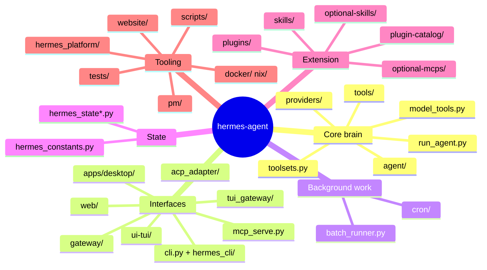

---

## 7. Features (what Hermes can do)

- **Chat anywhere:**
  - local: CLI, TUI, desktop app, web dashboard
  - messaging: about 20 platforms (Telegram, Discord, Slack, WhatsApp, Signal, Matrix, Teams, Email, SMS, IRC, Feishu, DingTalk, WeCom, LINE…)
  - integrations: ACP for editors, an MCP server mode, an HTTP API server and webhooks
- **Many model providers:** Anthropic, OpenAI (chat + Responses), OpenRouter, Bedrock, Vertex/Gemini, Mistral, Nous, local OpenAI-compatible servers. Supports fallback models, credential pools and reasoning config. Switch with `hermes model` or `/model`.
- **Tools:**
  - terminal (local, docker, ssh, cloud sandboxes) and background process management
  - file read/write/patch/search
  - web search/extract
  - full browser automation (CDP)
  - vision, image generation, TTS/voice
  - code execution
  - computer use
  - todo lists, clarifying questions
  - session history search
  - MCP client (any MCP server's tools)
- **Learning:** persistent memory (`MEMORY.md`/`USER.md` plus pluggable providers) and skills it can view, create and curate. A background review after turns updates memory and skills. Skills install from hubs (`hermes skills`).
- **Sub-agents:** `delegate_task`, run in parallel or in the background, optionally in isolated git worktrees.
- **Scheduling:** cron jobs (`hermes cron`, `/cron`, or the agent's `cronjob_manage` tool) that run the agent and deliver results to a chat.
- **Kanban:** a task board with a dispatcher that hands cards to agents.
- **Session control:** `/new`, `/retry`, `/undo`, `/rollback`, `/branch`, `/compress`, `/bg`, `/queue`, `/steer`, `/goal`, `/loop`, `/plan`, `/moa`, `/handoff`. Also checkpoints, backups, export/import.
- **Safety:** an approval system for dangerous commands (`/approve`, `/deny`, `hermes approvals`), per-platform user authorization/pairing, a security scan, a vault for secrets, and Docker egress controls.
- **Profiles:** fully isolated agent identities (separate config, memory, sessions) with `-p <name>`, and one gateway can serve several of them.
- **Ops:**
  - `hermes doctor`, `status`, `logs`, `insights`/`usage`
  - `update` (self-updater)
  - `pm` (dependency env)
  - OTLP telemetry (opt-in)
  - i18n

**Feature map:**

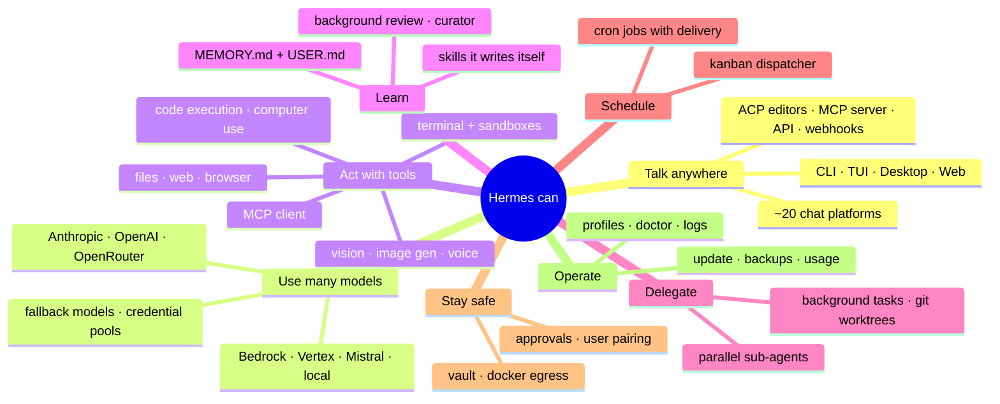

---

## 8. Recommended reading order for day 1
1. `AGENTS.md` (root): the rules and the routing table.
2. `website/docs/developer-guide/agent-loop.md`, `prompt-assembly.md`, `context-compression-and-caching.md`.
3. `run_agent.py` → `agent/turn_facade.py` → `agent/conversation_loop.py` (read the phase order).
4. `tools/registry.py` + one simple tool (`tools/todo_tool.py`) + `model_tools.handle_function_call`.
5. `toolsets.py`.
6. `hermes_cli/main.py::main` and `hermes_cli/commands.py`.
7. `gateway/run_inbound.py::_handle_message` → `gateway/run_turn.py::_run_agent`.
8. `hermes_state_schema.py` for the DB tables.
9. One area `AGENTS.md` for wherever you'll work first.

Hands-on:
- `source ./activate`, set a temp `HERMES_HOME`, `hermes setup`, `hermes`
- run tests with `scripts/run_tests.sh tests/agent/` (never bare pytest)
- run lint with `python scripts/check`
